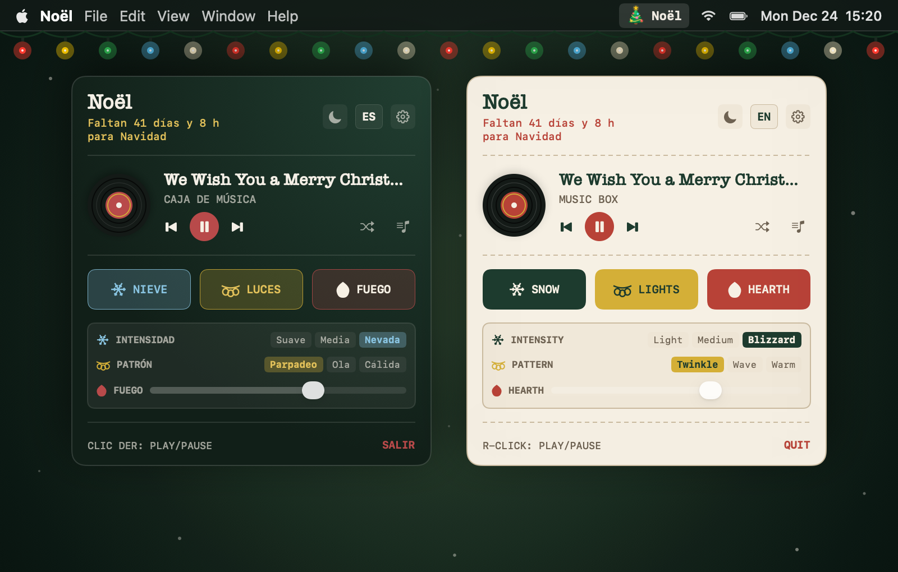
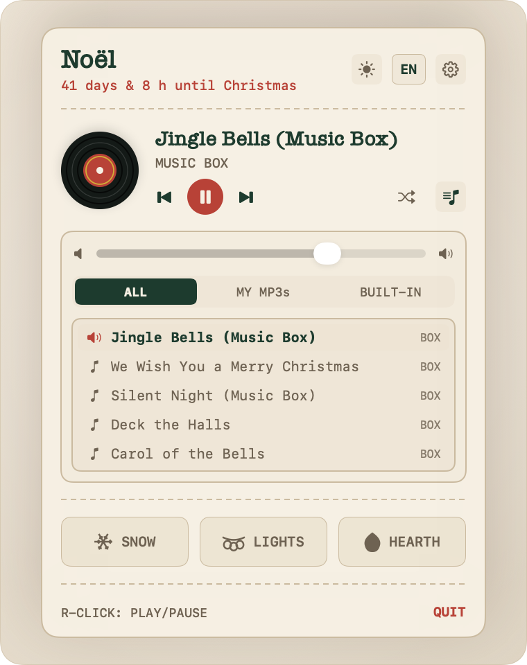
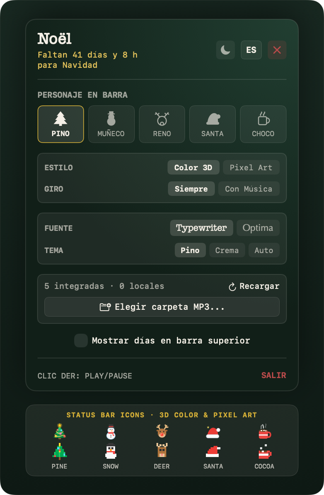

<div align="center">

# Noël

**Reproductor navideño artesanal para la barra de menú de macOS · An artisanal holiday companion for the macOS menu bar.**

<p>
  <a href="https://github.com/Dmian0/noel/releases/tag/v1.2.0"></a>
  
  
  <a href="https://github.com/Dmian0/homebrew-noel"></a>
  <a href="#licencia--license"></a>
</p>

<p>
  <a href="#español">Español</a> ·
  <a href="#instalación-rápida--quick-install">Instalación</a> ·
  <a href="#galería--gallery">Galería</a> ·
  <a href="#controles-rápidos">Controles</a> ·
  <a href="#english">English</a> ·
  <a href="#instalación-rápida--quick-install">Installation</a> ·
  <a href="#quick-controls">Controls</a> ·
  <a href="#features">Features</a> ·
  <a href="#compilar-desde-fuente--build-from-source">Build</a>
</p>

<br />



</div>

---

<a id="instalacion"></a>
## Instalación rápida / Quick Install

**Homebrew (recomendado / recommended):**

```bash
brew install --cask Dmian0/noel/noel
```
*Para actualizar a una nueva versión / To upgrade:* `brew update && brew upgrade --cask noel`

**Terminal (`curl` 1-liner):**

```bash
curl -fsSL https://raw.githubusercontent.com/Dmian0/noel/main/install.sh | bash
```

**Descarga directa / Direct download:**

Descarga [Noel.zip](https://github.com/Dmian0/noel/releases/latest/download/Noel.zip) desde la sección de lanzamientos de GitHub. Compatible con macOS 13.0 (Ventura) o posterior. Tanto `install.sh` como el Cask de Homebrew limpian automáticamente los atributos de cuarentena de Gatekeeper mediante `xattr -cr`.

---

<a id="galeria"></a>
## Galería / Gallery

<div align="center">
<table border="0" cellpadding="8" cellspacing="0">
  <tr>
    <td align="center" width="50%" valign="top">
      <b>Modo Pino (Dark · ES)</b><br /><br />
      <br /><br />
      <sub>Cuenta regresiva en tiempo real, efectos activos (Nieve, Luces, Fuego) e intensidad de nevada Blizzard.</sub>
    </td>
    <td align="center" width="50%" valign="top">
      <b>Modo Crema (Light · EN)</b><br /><br />
      <br /><br />
      <sub>Lista de canciones integrada desplegada, paleta de papel crema cálido y selector bilingüe instantáneo.</sub>
    </td>
  </tr>
  <tr>
    <td align="center" colspan="2" valign="top">
      <br />
      <b>Ajustes, Tipografía e Iconos (Color 3D y Pixel Art)</b><br /><br />
      <br /><br />
      <sub>Cinco personajes exclusivos (Pine / Pino, Snowman / Muñeco, Reindeer / Reno, Santa, Cocoa / Chocolate), modos 3D y Pixel Art, controles de rotación, tipografías American Typewriter y Optima, y vinculación de carpeta local MP3.</sub>
    </td>
  </tr>
</table>
</div>

---

<a id="espanol"></a>
## Español

**Noël** es una utilidad artesanal para la barra de menú de macOS diseñada para transformar tu espacio de trabajo durante la temporada festiva. Desarrollada de forma nativa en Swift y SwiftUI con AppKit, combina música navideña procedural estilo caja de música, sonido de leña crepitante generado por síntesis de audio en tiempo real, viento invernal en estéreo, iconos animados vectoriales en 3D y Pixel Art, nevada interactiva sobre la pantalla, guirnaldas de luces superiores y el trineo de Santa Claus cruzando tus monitores.

<a id="controles-rapidos"></a>
### Controles Rápidos

| Control / Gesto | Acción |
| :--- | :--- |
| **Clic izquierdo en el icono** | Abre o cierra el panel compacto con la cuenta regresiva navideña y el reproductor de audio. |
| **Clic derecho en el icono** | Alterna Reproducir / Pausar al instante sin desplegar el panel. |
| **Option (⌥) + Clic en el icono** | Alterna el Modo Reunión / Llamada (también accesible desde el botón de ojo en el panel): oculta o reanuda de inmediato todos los efectos visuales de pantalla (nieve, luces y trineo) conservando intacta tu configuración. |
| **Pastillas de ambiente (Nieve, Luces, Fuego)** | Activa o desactiva las capas transparentes de efectos visuales y el crepitar de chimenea; revela controles contextuales de intensidad de nevada (`Suave`, `Media`, `Nevada / Blizzard`), capa de visualización (`Sobre todo` / `Solo escritorio`), viento invernal procedural con volumen independiente, patrones luminosos (`Parpadeo`, `Ola`, `Fija`, `Ritmo`), 5 paletas de color para luces y selectores independientes de estilo `3D` vs `Pixel Art`. |
| **Duendes de la nieve** | Selector `DUENDES` (`No` \| `1` \| `Equipo`) con selector independiente de estilo `3D` \| `PX`. Activa ayudantes que limpian la nieve, asisten a Santa, construyen muñecos y reaccionan a tus bolas de nieve. |
| **Nieve e interacción en pantalla** | Pasa el cursor por el manto inferior para apartar la nieve (quitanieves reactivo) o mantén presionado y arrastra hacia arriba para formar y disparar bolas de nieve con física gravitatoria: haz oscilar y destellar las bombillas superiores, derriba a Santa hasta el banco de nieve inferior o derriba a los duendes y muñecos de nieve (provocando que los duendes contraataquen lanzándote bolas de nieve hacia el cursor). |
| **El Trineo de Santa** | Configura la frecuencia de aparición periódica (`No`, `Ocasional`, `Frecuente`), activa o desactiva cascabeles procedurales o pulsa **Volar** para invocar a Santa y sus renos de inmediato a través de la pantalla. |
| **Selector de carpeta de música** | Vincula cualquier carpeta local con archivos MP3, M4A, WAV o FLAC junto a las cinco melodías de caja de música integradas. |

### Características Principales

- **El Trineo de Santa Claus:**  
  Apariciones periódicas configurables (`No`, `Ocasional`, `Frecuente`) o invocación manual inmediata con el botón **Volar** en el panel. Santa, Rudolph con nariz roja brillante y sus renos cruzan toda la pantalla a través de 4 trayectorias orgánicas (`diagonalClimb`, `panoramicWave`, `centerDive`, `sweepingArc`), dejando una estela dorada de partículas resplandecientes, soltando regalos con paracaídas flotante y acompañados de un tintineo procedural de cascabeles con paneo estéreo binaural. Si alcanzas el trineo en vuelo con una bola de nieve, soltará 3 regalos en paracaídas y caerá en espiral descontrolada dejando una estela de chispas hasta estrellarse sobre el banco inferior, abriendo un cráter físico en la nieve; tras quedar aturdido con estrellas giratorias durante unos segundos, se reincorporará y despegará de nuevo. Los regalos caídos reposan sobre el manto de nieve y explotan en destellos al pasar el cursor sobre ellos o al ser recogidos por los duendes.

- **Duendes Limpiadores, Rescate de Santa, Batalla de Bolas de Nieve y Muñecos de Nieve:**  
  Pequeños ayudantes autónomos que patrullan y habitan el manto de nieve inferior (`1` duende o `Equipo` de 3 duendes). Palean montículos de nieve acumulada y empujan una pala quitanieves mecánica durante la intensidad Ventisca (`Blizzard`). Si Santa cae derribado, los duendes corren a desenterrar el trineo con sus palas para ayudarle a despegar antes. También recogen los regalos posados sobre la nieve y arman muñecos de nieve en 3 etapas con bufanda y sombrero de copa, los cuales estallan en nieve al golpearlos con una bola de nieve. Si golpeas a un duende con una bola de nieve, caerá sentado en la nieve con estrellitas y, al levantarse, contraatacará lanzándote una bolita de nieve hacia la posición de tu cursor. Disponibles con renderizado independiente en `3D Vectorial` o `Pixel Art 8-bit`.

- **Nevada Interactiva, Física y Manto «Camaleón»:**  
  Tres planos de profundidad con hasta 300 copos simultáneos en modo `Nevada (Blizzard)`, ráfagas diagonales reactivas al cursor y acumulación progresiva sobre el borde inferior de la pantalla. Manto continuo suave de 44 pt sin costuras verticales ni cortes artificiales, con física de quitanieves gaussiano al pasar el mouse. Selector de capa (`Sobre todo` / `Solo escritorio`) para enviar la nieve detrás de tus ventanas abiertas. Arquitectura ultra-eficiente basada en franja bitmap con *dirty rendering* y pools reutilizables de capas que mantiene el consumo de memoria optimizado en apenas `~16-40 MB de RAM`.

- **Guirnalda con 5 Paletas y Modo `Ritmo` (`Audio-Reactivo`):**  
  Guirnalda festoneada superior con 5 paletas de color artesanales (*Clásica Multicolor*, *Blanco Cálido*, *Bastón de Caramelo*, *Hielo Nórdico* y *Pino y Oro*) con previsualización de puntos de color. Bombillas radiantes limpias con halo de gradiente radial suave (`CGGradient` en 3D y anillos concéntricos en Pixel Art), casquillo con borde dorado y destello especular de cristal sobre cada bulbo. Cuarto patrón de iluminación **`Ritmo`** que hace latir las bombillas con reactividad de doble banda: espectro sonoro en tiempo real para música integrada en `AVAudioPlayer` y pulso sincronizado con la reproducción activa en Spotify o Apple Music.

- **Estilos `Color 3D` y `Pixel Art` Independientes:**  
  Libertad total para mezclar estéticas visuales: elige por separado `3D` o `Pixel Art` de 8 bits en los copos de nieve, el manto inferior acumulado, los duendes de la nieve, la guirnalda de luces superior y el personaje de la barra de estado.

- **Viento Invernal en Estéreo y Comodidad en el Día a Día:**  
  Síntesis procedural en tiempo real de viento invernal con ruido rosa filtrado, fluctuación estocástica de ráfagas y paneo estéreo, con control de volumen independiente y auto-activación al activar la intensidad Blizzard. Atajo rápido `Option + Clic` (o botón de ojo en el panel) para llamadas y pantalla compartida, e interruptor nativo para iniciar automáticamente al encender la Mac (`Launch at Login` mediante `SMAppService` en macOS 13+).

- **Integración Nativa con Spotify y Apple Music:**  
  Selector `NOËL | SPOTIFY | APPLE MUSIC` para sincronizar en tiempo real el título de pista, subtítulo y estado de reproducción, permitiendo controlar avance, retroceso, pausa y volumen sin interrumpir los ambientes sonoros de chimenea y viento invernal.

- **Audio Procedural en Tiempo Real:**  
  Cinco villancicos clásicos sintetizados nota a nota mediante síntesis de ondas (*Jingle Bells*, *We Wish You a Merry Christmas*, *Noche de Paz / Silent Night*, *Deck the Halls*, *Carol of the Bells*). Generador continuo de chimenea con 12 segundos de audio procedimental con algoritmos estocásticos para emular el crujido y las chispas de la madera, sin muestras pregrabadas ni consumo de red. Compatibilidad total con bibliotecas locales de audio en formatos MP3, M4A, WAV y FLAC.

- **Soporte Multipantalla:**  
  Selector de pantallas (`Todas` / `Principal`) que extiende la nevada, las guirnaldas de luces y el vuelo de Santa a todos los monitores conectados, escalando dinámicamente la cantidad de copos, bombillas y dimensiones a cada resolución.

- **Diseño Artesanal y Personalización:**  
  Estética cuidada sin emojis en los textos de interfaz. Modos de apariencia Pino Nocturno (Dark), Papel Crema (Light) y Automático (según el sistema), sincronizando el contenedor popover y su flecha de anclaje. Tipografía seleccionable entre American Typewriter y Optima. Cinco figuras para la barra de estado (*Pino*, *Muñeco de nieve*, *Reno Rudolph*, *Gorro de Santa*, *Taza de Chocolate*) con rotación en 3D vectorial o Pixel Art de 8 bits. Contador opcional de días restantes visible directamente en la barra de menú.

---

<a id="english"></a>
## English

**Noël** is an artisanal macOS menu bar companion designed to bring warm, festive cheer to your workspace during the holiday season. Built natively with Swift, SwiftUI, and AppKit, it combines real-time procedural music-box melodies, cozy hearth crackle synthesis, stereo procedural winter wind, 3D rotating and 8-bit Pixel Art status icons, interactive falling snow, top festoon lights, and Santa's flying sleigh across your displays.

<a id="quick-controls"></a>
### Quick Controls

| Control / Gesture | Action |
| :--- | :--- |
| **Left-click on menu bar icon** | Opens or closes the compact holiday popover with live Christmas countdown and audio player. |
| **Right-click on menu bar icon** | Instantly toggles Play / Pause without expanding the popover panel. |
| **Option (⌥) + Click on menu bar icon** | Toggles Meeting / Screen Sharing Mode (also available via the eye button in the panel header): instantly hides or resumes all visual screen overlays (snow, lights, sleigh) while preserving your active settings. |
| **Ambient pills (Snow, Lights, Hearth)** | Toggles click-through visual overlay layers and procedural fire crackle; reveals contextual controls for snow intensity (`Light`, `Medium`, `Blizzard`), rendering layer (`Above all` / `Desktop`), independent procedural winter wind volume, lighting patterns (`Twinkle`, `Wave`, `Steady`, `Rhythm`), 5 color palettes, and independent `3D` / `Pixel Art` style selectors. |
| **Snow Elves** | `ELVES` selector (`Off` \| `1` \| `Crew`) with independent `3D` \| `PX` style toggle. Enables autonomous helpers that shovel snow, rescue Santa, build snowmen, and react to thrown snowballs. |
| **Snow & on-screen interactivity** | Hover over the bottom snowbank to clear a smooth path (interactive snowplow) or click-and-drag upward from the snow to shape and throw snowballs with realistic gravity: shake and flash top garland lights, shoot down Santa into the bottom snowbank, or knock down elves and snowmen (prompting elves to retaliate by hurling snowballs at your cursor). |
| **Santa's Sleigh** | Configure periodic flights (`Off`, `Occasional`, `Frequent`), toggle procedural sleigh bells, or press **Fly** to invoke Santa and his reindeer across the screen immediately. |
| **Music folder picker** | Links any local folder containing MP3, M4A, WAV, or FLAC audio files alongside the 5 built-in procedural music-box melodies. |

<a id="features"></a>
### Key Features

- **Santa's Flying Sleigh:**  
  Customizable periodic flight frequency (`Off`, `Occasional`, `Frequent`) or instant manual invocation via the **Fly** button. Santa, bright red-nosed Rudolph, and reindeer gallop across the entire screen along 4 organic flight trajectories (`diagonalClimb`, `panoramicWave`, `centerDive`, `sweepingArc`), leaving a golden stardust trail, dropping parachute gifts, and accompanied by procedural sleigh bells with stereo binaural panning. Hitting Santa in flight with a snowball drops 3 parachute gifts and sends the sleigh into a spiraling spin trailing smoke sparks to a crash landing on the bottom snowbank, carving an interactive physical crater; after sitting dazed with rotating stars for a few moments, Santa recovers and lifts off again. Grounded gifts rest upon the snowbank, bursting into holiday sparkles when hovered by your cursor or collected by the elves.

- **Autonomous Cleaning Elves, Santa Rescue, Snowball Battles & Snowmen:**  
  Little autonomous companions patrolling and living on the bottom snowbank (`1` elf or a 3-elf `Crew`). They shovel accumulated snow mounds and push a mechanical snowplow blade during `Blizzard` mode. When Santa crash-lands, the elves rush to shovel snow around the sleigh and help him recover and take off faster. They also collect unattended grounded gifts and progressively build 3-stage snowmen with scarves and top hats that burst into snow when hit by a snowball. Hitting an elf knocks them sitting down with dizzy stars; once they get back up, they retaliate by throwing a snowball back toward your mouse cursor. Independently styled in smooth `Vector 3D` or 8-bit `Pixel Art`.

- **Interactive Snowfall, Physics & "Chameleon" Snowbank:**  
  Three depth layers with up to 300 simultaneous flakes in `Blizzard` mode, diagonal wind gusts reactive to cursor movement, and progressive accumulation along the bottom screen edge. A continuous 44 pt seamless snowbank without column seams or gaps, featuring smooth Gaussian snowplow carving on mouse hover. Render layer selector (`Above all` / `Desktop`) to send snow behind open windows. Ultra-lean bitmap strip architecture with dirty-frame rendering and reusable layer pools keeping total RAM usage around `~16-40 MB`.

- **Festoon Garland with 5 Palettes & Audio-Reactive `Rhythm`:**  
  Top festoon garland featuring 5 handcrafted color palettes (*Classic Multicolor*, *Warm White*, *Candy Cane*, *Nordic Ice*, and *Pine & Gold*) with visual color dot swatches. Clean radiant bulbs with soft radial gradient halos (`CGGradient` in 3D and stepped concentric rings in Pixel Art), gold-rimmed brass sockets, and specular glass highlights on each bulb. A 4th lighting pattern, **`Rhythm`**, providing dual-band audio reactivity: real-time spectral measurement via `AVAudioPlayer` decibels for built-in tunes and rhythmic pulse synchronization with active playback in Spotify or Apple Music.

- **Independent `Color 3D` & `Pixel Art` Styles:**  
  Complete freedom to mix aesthetics: individually select `3D` or 8-bit `Pixel Art` rendering for snowflakes, the bottom snowbank, snow elves, top garland lights, and the menu bar status icon/sleigh.

- **Stereo Winter Wind & Everyday Convenience:**  
  Real-time procedural winter wind synthesis using filtered pink noise, stochastic gusting, and stereo panning, featuring an independent volume slider and auto-activation in Blizzard mode. Instant `Option + Click` Meeting Mode (or header eye button) for calls and screen sharing, plus native launch at login toggle powered by `SMAppService` on macOS 13+.

- **Native Spotify & Apple Music Integration:**  
  Source selector (`NOËL | SPOTIFY | APPLE MUSIC`) to sync the active track and artist in real time and control Play/Pause, Next, Previous, Shuffle, and Volume while keeping procedural fireplace hearth and winter wind audio independent.

- **Procedural Audio Synthesis:**  
  Five holiday tunes synthesized in real time (*Jingle Bells*, *We Wish You a Merry Christmas*, *Silent Night*, *Deck the Halls*, *Carol of the Bells*). Loopable 12-second procedural fireplace audio generating wood-burning crackles, pops, and warm low-frequency embers through stochastic algorithms without audio samples or network calls. Full support for local audio folders containing MP3, M4A, WAV, or FLAC tracks.

- **Multi-Display Support:**  
  Display target selector (`All` / `Main`) extending falling snow, top festoon lights, and Santa's flight across all connected monitors, dynamically scaling snowflake density, bulb counts, and trajectory dimensions to each screen's resolution.

- **Artisanal Craft & Design:**  
  Clean, typography-driven interface with zero emojis in UI strings. Pine Dark, Cream Light, and System Auto palettes that style both the view and native popover frame. Choose between American Typewriter and Optima typography. Five handcrafted status bar characters (*Pine Tree*, *Snowman*, *Rudolph Reindeer*, *Santa Hat*, *Hot Cocoa Mug*) in smooth 3D vector or 8-bit Pixel Art rendering. Optional compact countdown tag displayed beside the status icon.

---

<a id="compilar-desde-fuente--build-from-source"></a>
<a id="build"></a>
## Compilar desde fuente / Build from Source

Requisitos: macOS 13.0 (Ventura) o posterior y Xcode Command Line Tools.  
*Requirements: macOS 13.0 (Ventura) or later, Xcode Command Line Tools.*

```bash
git clone https://github.com/Dmian0/noel.git
cd noel
./build_app.sh
```

El script compila el binario en modo release (`swift build -c release`), genera el bundle `Noel.app`, aplica la firma de código ad-hoc (`codesign`), empaqueta `Noel.zip` y calcula su suma de verificación SHA-256 para distribución.

---

<a id="licencia--license"></a>
## Licencia / License

MIT License. Designed with care for macOS.
