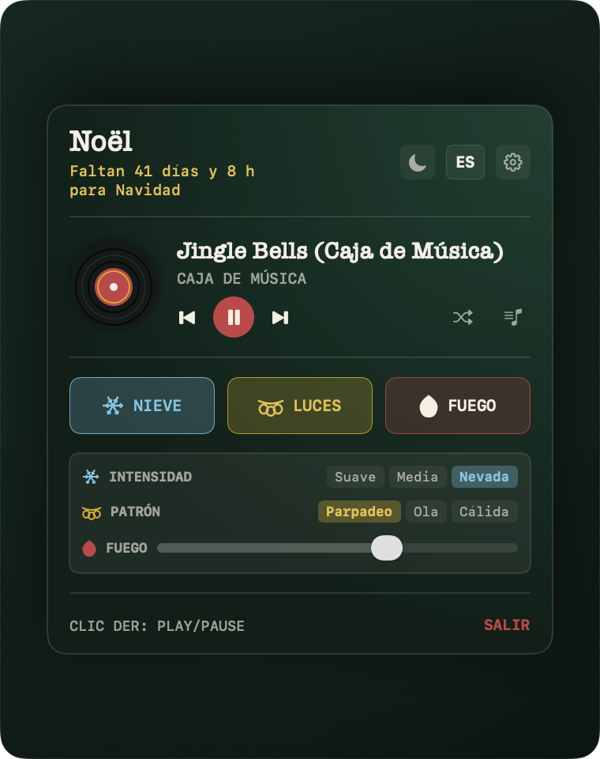

<div align="center">

# Noël

**Reproductor navideño artesanal para la barra de menú de macOS · An artisanal holiday companion for the macOS menu bar.**

<p>
  <a href="https://github.com/Dmian0/noel/releases/tag/v1.0.1"></a>
  
  
  <a href="https://github.com/Dmian0/homebrew-noel"></a>
  <a href="#licencia--license"></a>
</p>

<p>
  <a href="#español">Español</a> ·
  <a href="#instalación-rápida--quick-install">Instalación</a> ·
  <a href="#galería--gallery">Galería</a> ·
  <a href="#controles-rápidos">Controles</a> ·
  <a href="#english">English</a> ·
  <a href="#instalación-rápida--quick-install">Installation</a> ·
  <a href="#quick-controls">Controls</a> ·
  <a href="#features">Features</a> ·
  <a href="#compilar-desde-fuente--build-from-source">Build</a>
</p>

<br />


</div>

---

<a id="instalacion"></a>
## Instalación rápida / Quick Install

**Homebrew (recomendado / recommended):**

```bash
brew install --cask Dmian0/noel/noel
```
*Para actualizar a una nueva versión / To upgrade:* `brew update && brew upgrade --cask noel`

**Terminal (`curl` 1-liner):**

```bash
curl -fsSL https://raw.githubusercontent.com/Dmian0/noel/main/install.sh | bash
```

**Descarga directa / Direct download:**

Descarga [Noel.zip](https://github.com/Dmian0/noel/releases/latest/download/Noel.zip) desde la sección de lanzamientos de GitHub. Compatible con macOS 13.0 (Ventura) o posterior. Tanto `install.sh` como el Cask de Homebrew limpian automáticamente los atributos de cuarentena de Gatekeeper mediante `xattr -cr`.

---

<a id="galeria"></a>
## Galería / Gallery

<div align="center">
<table border="0" cellpadding="8" cellspacing="0">
  <tr>
    <td align="center" width="50%" valign="top">
      <b>Modo Pino (Dark · ES)</b><br /><br />
      <br /><br />
      <sub>Cuenta regresiva en tiempo real, efectos activos (Nieve, Luces, Fuego) e intensidad de nevada Blizzard.</sub>
    </td>
    <td align="center" width="50%" valign="top">
      <b>Modo Crema (Light · EN)</b><br /><br />
      <br /><br />
      <sub>Lista de canciones integrada desplegada, paleta de papel crema cálido y selector bilingüe instantáneo.</sub>
    </td>
  </tr>
  <tr>
    <td align="center" colspan="2" valign="top">
      <br />
      <b>Ajustes, Tipografía e Iconos (Color 3D y Pixel Art)</b><br /><br />
      <br /><br />
      <sub>Cinco personajes exclusivos (Pine / Pino, Snowman / Muñeco, Reindeer / Reno, Santa, Cocoa / Chocolate), modos 3D y Pixel Art, controles de rotación, tipografías American Typewriter y Optima, y vinculación de carpeta local MP3.</sub>
    </td>
  </tr>
</table>
</div>

---

<a id="espanol"></a>
## Español

**Noël** es una utilidad artesanal para la barra de menú de macOS diseñada para transformar tu espacio de trabajo durante la temporada festiva. Desarrollada de forma nativa en Swift y SwiftUI con AppKit, combina música navideña procedural estilo caja de música, sonido de leña crepitante generado por síntesis de audio en tiempo real, iconos animados vectoriales en 3D y Pixel Art, nevada interactiva sobre la pantalla y guirnaldas de luces superiores.

<a id="controles-rapidos"></a>
### Controles Rápidos

| Control / Gesto | Acción |
| :--- | :--- |
| **Clic izquierdo en el icono** | Abre o cierra el panel compacto con la cuenta regresiva navideña y el reproductor de audio. |
| **Clic derecho en el icono** | Alterna Reproducir / Pausar al instante sin desplegar el panel. |
| **Pastillas de ambiente (Nieve, Luces, Fuego)** | Activa o desactiva las capas transparentes de efectos visuales y el crepitar de chimenea; revela controles contextuales de intensidad de nevada (Suave, Media, Nevada Blizzard) y patrones luminosos (Parpadeo, Ola, Cálida). |
| **Selector de carpeta de música** | Vincula cualquier carpeta local con archivos MP3, M4A, WAV o FLAC junto a las cinco melodías de caja de música integradas. |

### Características Principales

- **Integración con Spotify y Apple Music:**  
  Selector `NOËL | SPOTIFY | APPLE MUSIC` para sincronizar en tiempo real la canción y el artista activos y controlar reproducción, pista siguiente/anterior, modo aleatorio y volumen, manteniendo independiente el sonido de chimenea.

- **Soporte Multipantalla:**  
  Selector de pantallas (`Todas` / `Principal`) que extiende la nevada y las guirnaldas de luces a todos los monitores conectados, escalando dinámicamente la cantidad de copos y bombillas según el ancho de cada pantalla.

- **Audio Procedural en Tiempo Real:**  
  Cinco villancicos clásicos sintetizados nota a nota mediante síntesis de ondas (*Jingle Bells*, *We Wish You a Merry Christmas*, *Noche de Paz / Silent Night*, *Deck the Halls*, *Carol of the Bells*). Generador continuo de chimenea con 12 segundos de audio procedimental con algoritmos estocásticos para emular el crujido y las chispas de la madera, sin muestras pregrabadas ni consumo de red. Compatibilidad total con bibliotecas locales de audio en formatos MP3, M4A, WAV y FLAC.

- **Efectos de Pantalla Transparentes:**  
  Capa flotante no interactiva (*click-through*) que despliega una nevada suave o tormenta sobre todo el escritorio (hasta 260 copos con balanceo de viento calculado dinámicamente según intensidad: Suave, Media, Nevada). Guirnalda festoneada de bombillas festivas sobre el borde superior de la pantalla con modos de iluminación Parpadeo, Ola rítmica y Brillo cálido constante.

- **Diseño Artesanal y Personalización:**  
  Estética cuidada sin emojis en los textos de interfaz. Modos de apariencia Pino Nocturno (Dark), Papel Crema (Light) y Automático (según el sistema), sincronizando el tinte del contenedor popover y su flecha de anclaje. Tipografía seleccionable entre American Typewriter y Optima. Cinco figuras para la barra de estado (*Pino*, *Muñeco de nieve*, *Reno Rudolph*, *Gorro de Santa*, *Taza de Chocolate*) con rotación en 3D vectorial o Pixel Art de 8 bits. Contador opcional de días restantes visible directamente en la barra de menú.

---

<a id="english"></a>
## English

**Noël** is an artisanal macOS menu bar companion designed to bring warm, festive cheer to your workspace during the holiday season. Built natively with Swift, SwiftUI, and AppKit, it combines real-time procedural music-box melodies, cozy hearth crackle synthesis, 3D rotating and 8-bit Pixel Art status icons, interactive falling snow, and top festoon lights.

<a id="quick-controls"></a>
### Quick Controls

| Control / Gesture | Action |
| :--- | :--- |
| **Left-click on menu bar icon** | Opens or closes the compact holiday popover with live Christmas countdown and audio player. |
| **Right-click on menu bar icon** | Instantly toggles Play / Pause without expanding the popover panel. |
| **Ambient pills (Snow, Lights, Hearth)** | Toggles click-through visual overlay layers and procedural fire crackle; reveals contextual sliders and patterns (Light, Medium, Blizzard snow; Twinkle, Wave, Warm glow lights). |
| **Music folder picker** | Links any local folder containing MP3, M4A, WAV, or FLAC audio files alongside the 5 built-in procedural music-box melodies. |

<a id="features"></a>
### Key Features

- **Native Spotify & Apple Music Integration:**  
  Source selector (`NOËL | SPOTIFY | APPLE MUSIC`) to sync the active track and artist in real time and control Play/Pause, Next, Previous, Shuffle, and Volume while keeping procedural fireplace hearth audio independent.

- **Multi-Display Support:**  
  Display target selector (`All` / `Main`) extending falling snow and top holiday lights across all connected monitors, dynamically scaling snowflake density and light bulb counts to each screen's width.

- **Procedural Audio Synthesis:**  
  Five holiday tunes synthesized in real time (*Jingle Bells*, *We Wish You a Merry Christmas*, *Silent Night*, *Deck the Halls*, *Carol of the Bells*). Loopable 12-second procedural fireplace audio generating wood-burning crackles, pops, and warm low-frequency embers through stochastic algorithms without audio samples or network calls. Full support for local audio folders containing MP3, M4A, WAV, or FLAC tracks.

- **Screen Overlays (Click-Through):**  
  Full-screen transparent floating window hosting wind-blown procedural snowflakes (up to 260 flakes reacting to selected intensity: Light, Medium, or Blizzard). Scalloped holiday light garland along the top menu bar edge featuring Twinkle, Wave, and Warm steady illumination patterns.

- **Artisanal Craft & Design:**  
  Clean, typography-driven interface with zero emojis in UI strings. Pine Dark, Cream Light, and System Auto palettes that style both the view and native popover frame. Choose between American Typewriter and Optima typography. Five handcrafted status bar characters (*Pine Tree*, *Snowman*, *Rudolph Reindeer*, *Santa Hat*, *Hot Cocoa Mug*) in smooth 3D vector or 8-bit Pixel Art rendering. Optional compact countdown tag displayed beside the status icon.

---

<a id="compilar-desde-fuente--build-from-source"></a>
<a id="build"></a>
## Compilar desde fuente / Build from Source

Requisitos: macOS 13.0 (Ventura) o posterior y Xcode Command Line Tools.  
*Requirements: macOS 13.0 (Ventura) or later, Xcode Command Line Tools.*

```bash
git clone https://github.com/Dmian0/noel.git
cd noel
./build_app.sh
```

El script compila el binario en modo release (`swift build -c release`), genera el bundle `Noel.app`, aplica la firma de código ad-hoc (`codesign`), empaqueta `Noel.zip` y calcula su suma de verificación SHA-256 para distribución.

---

<a id="licencia--license"></a>
## Licencia / License

MIT License. Designed with care for macOS.
